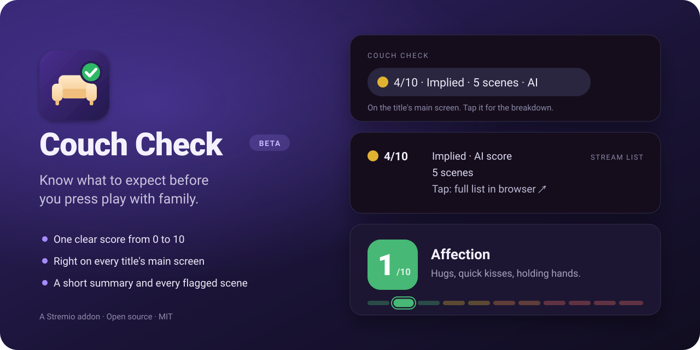

<p align="center">
  
</p>

<p align="center">
  
  
  
  
  
</p>

> [!NOTE]
> **Couch Check is in beta.** The scoring rubric is still being tuned, so a score can occasionally be off. Every score links to the scene-by-scene list it came from, so you can always check for yourself.

## What it does

Couch Check reads each title's IMDb parents guide and turns its intimate-content section into one clear number, so you can decide in seconds whether something is right for movie night.

- **One score, 0–10.** The score is the most intense moment in the title, on a fixed ladder where every number means something specific.
- **On the title's main screen.** A *Couch Check* chip sits right under the rating, before you even pick an episode.
- **A breakdown inside Stremio.** Tap the chip for a short summary and every flagged scene, grouped by level, with spoilers hidden.
- **In every stream list.** A row at the top of each episode's and movie's sources.
- **AI score or quick estimate.** Every score is labelled. `AI` means an AI model read each scene description and understood its context (a joke about something isn't the same as seeing it). `Est.` is a rougher keyword estimate, shown until the AI has scored a title, or always if you turn AI off.

## The scale

| Score | Name |
|---|---|
| 0 | None |
| 1 | Affection |
| 2 | Romance |
| 3 | Suggestive |
| 4 | Implied |
| 5 | Brief Partial N*dity |
| 6 | S*x Scene, Covered |
| 7 | Topless |
| 8 | S*x Scene with N*dity |
| 9 | Full Frontal |
| 10 | Graphic |

Next to the score you'll also see how many **scenes** are at level 4 or above, how many are **prolonged**, whether a show's score is **show-wide**, and **low confidence** when IMDb has very little to go on.

## Set up your own

> [!NOTE]
> **There's no public instance yet.** Stremio's free community hosting (BeamUp) isn't starting new addons at the moment, so for now everyone runs their own copy. It takes about ten minutes, and a free hosted version for everyone may come later.

Couch Check needs only Python 3.9+, with no packages to install. Stremio only installs addons over **HTTPS**, so you either run it on your computer through a free tunnel (step 2a) or host it for free (step 2b).

### 1. Get an AI key (optional, free)

Without a key everything works, with keyword estimates instead of AI scores.

1. Create an account at [console.groq.com](https://console.groq.com) (no payment method needed) and create an API key.
2. Copy `.env.example` to `.env` and paste the key after `PG_AI_API_KEY=`. Any OpenAI-compatible API works; the template is set up for Groq's free tier.

> [!IMPORTANT]
> Treat the key like a password. `.env` is git-ignored, so never force-add it, and never paste the key into issues, chats or screenshots. If it leaks, revoke it in Groq's console and create a new one.

### 2a. Run it on your computer

```bash
git clone https://github.com/EnigmaticZee/couch-check.git
cd couch-check
brew install cloudflared   # or download it from Cloudflare's cloudflared releases page
./start.sh
```

`start.sh` starts the addon and a Cloudflare quick tunnel, then prints a `https://….trycloudflare.com/configure` address. The address changes every time you start it, and the addon only works while your computer is on, so this suits trying it out. For the breakdown pages in a browser only, `python3 server.py` serves `http://localhost:7001`.

### 2b. Host it for free on Render

1. [Fork this repo](https://github.com/EnigmaticZee/couch-check/fork) to your GitHub account.
2. On [render.com](https://render.com), choose **New → Web Service** and connect your fork.
3. Pick **Docker** as the language and the **Free** instance type.
4. Under environment variables, add `PG_AI_BASE_URL`, `PG_AI_API_KEY` and `PG_AI_MODEL` with the values from `.env.example` and your key (skip this for estimates only).
5. Under advanced settings, set the health check path to `/manifest.json`, then deploy. Your address looks like `https://your-app.onrender.com`.
6. Free Render services sleep after 15 minutes without visits, and Stremio gives up before one wakes. Create a free [UptimeRobot](https://uptimerobot.com) HTTP monitor for `https://your-app.onrender.com/manifest.json` every 5 minutes to keep it awake.

Render's free disk is wiped on each deploy or restart, so titles are re-fetched and re-scored as they're opened; [saved scores](#saved-scores) keep the AI scores you care about. Any other host that runs Docker or Python with an HTTPS address works too: the [`Dockerfile`](Dockerfile) keeps the cache on a `/data` volume.

### 3. Install in Stremio

1. Open your address's `/configure` page and click **Install in Stremio**. Turn off **Use AI scores** there first if you only want estimates.
2. For the chip on the main screen, Couch Check has to sit **above Cinemeta** in your addon list. The Stremio app can't reorder addons, so use a community addon manager (search "Stremio Addon Manager"), drag Couch Check above Cinemeta, sync, and restart Stremio. The stream-list row works without this step.

If you share your copy with other people, set `PG_SCENE_TEXT=off` (see [About the data](#about-the-data)).

## Settings

Set these in `.env` locally, or as environment variables on your host.

| Variable | Default | |
|---|---|---|
| `PG_AI_BASE_URL`, `PG_AI_API_KEY`, `PG_AI_MODEL` | — | OpenAI-compatible API for AI scores (e.g. Groq) |
| `PG_AI_FALLBACK_KEY` | — | A backup key from another account, used while the main key is over its limit |
| `PG_AI_FALLBACK_MODEL` | — | A backup model on the main key (e.g. a smaller one), used while the main model is over its limit |
| `PG_AI_MIN_INTERVAL` | `1.5` | Seconds between AI calls |
| `PG_AI_DAILY_LIMIT` | `500` | Max AI calls per day; beyond that, new titles get estimates |
| `PG_AI_REASONING_EFFORT` | `low` for gpt-oss | Reasoning effort for reasoning models |
| `PG_CLASSIFIER` | — | `keywords` turns AI scoring off for everyone |
| `PG_SCENE_TEXT` | `on` | `off` shows scene counts per level with a link to IMDb instead of IMDb's scene descriptions |
| `PORT` | `7001` | 7000 is taken by macOS AirPlay Receiver |
| `PG_PUBLIC_URL` | from request | Public base URL, if your host's address isn't detected automatically |
| `PG_DB` | `./cache.sqlite3` | Cache location |
| `PG_SCORES` | `./data/scores.json` | Saved scores file |
| `PG_EXPORT_TOKEN` | — | Lets `tools/save_scores.py` download a hosted server's AI scores. Off while unset |
| `PG_OVERRIDES` | `./data/overrides.json` | Your own scores file |
| `PG_EXPERIMENTAL` | `off` | The experimental ISCCI rubric: `both` shows it next to the main score, `only` shows it alone; see `experimental/` |
| `PG_EPISODE_SCORES` | `off` | `on` scores episodes that have their own IMDb guide (experimental) |
| `PG_TV_DESCRIPTION` | `on` | Puts the score at the top of the description on Samsung TVs, which don't show the chip or row. `off` turns it off |

## Saved scores

[`data/scores.json`](data/scores.json) keeps AI scores in the repo, so they survive redeploys and cache resets: titles in it show their AI score straight away, without asking the AI again. It holds only IMDb item IDs, levels and short summaries, never IMDb's text.

```bash
python3 tools/save_scores.py                    # from your local cache
python3 tools/save_scores.py https://your-host  # from a hosted server
```

For a hosted server, set the same long random `PG_EXPORT_TOKEN` on the server and in your local `.env`. Then commit `data/scores.json` and redeploy. If the rubric version changes, the file starts fresh and titles are re-scored as they're opened.

## Your own scores

Disagree with a title's score after watching it? Add it to [`data/overrides.json`](data/overrides.json) and redeploy. Your level replaces the computed one everywhere, marked "Your score", with the AI's score shown alongside:

```json
{"tt0106179": {"level": 4, "note": "Milder than it sounds", "set": "2026-10-17"}}
```

## Checking the rubric

[`data/reference.json`](data/reference.json) lists titles with the level range they should land in. After changing the rubric or the AI instructions, run `python3 tools/check_rubric.py` to score them from scratch and see which still land on target.

## About the data

IMDb has no public API for parents guides. Couch Check uses the same endpoint IMDb's website uses, fetches only titles someone opens, and waits at least a second between requests. Finished titles (shows that have ended, movies more than a year old) are cached permanently; ongoing shows and recent movies are refreshed every three weeks. To force a refresh, run `python3 tools/refresh.py <imdb ids…>` where the server runs.

Scene descriptions in the breakdowns are written by IMDb's contributors; Couch Check only adds the levels and summaries. IMDb's terms allow only limited personal, non-commercial use of its data, so keep your copy personal, or set `PG_SCENE_TEXT=off` so breakdowns link to IMDb for the descriptions instead of showing them.

## 🗺️ Roadmap

**Shipped**

✅ Score chip on the title's main screen<br>
✅ In-app breakdown with a short summary and every flagged scene<br>
✅ Score row in every episode's and movie's stream list<br>
✅ Live AI scores, with a keyword estimate as the fallback<br>
✅ Content warnings shown next to the score<br>
✅ Your own score for a title after watching it<br>
✅ Samsung TV support, with the score in the description

**Up next**

⬜ Episode-level scores for shows (being tested)

**Someday, maybe**

🌙 Scene timing, so you can skip ahead <sub>— IMDb rarely says when a scene happens</sub><br>
🌙 Personal cut-offs, like one limit for family and another for just the two of you <sub>— Stremio can't tell who's watching</sub>

## License

[MIT](LICENSE)
